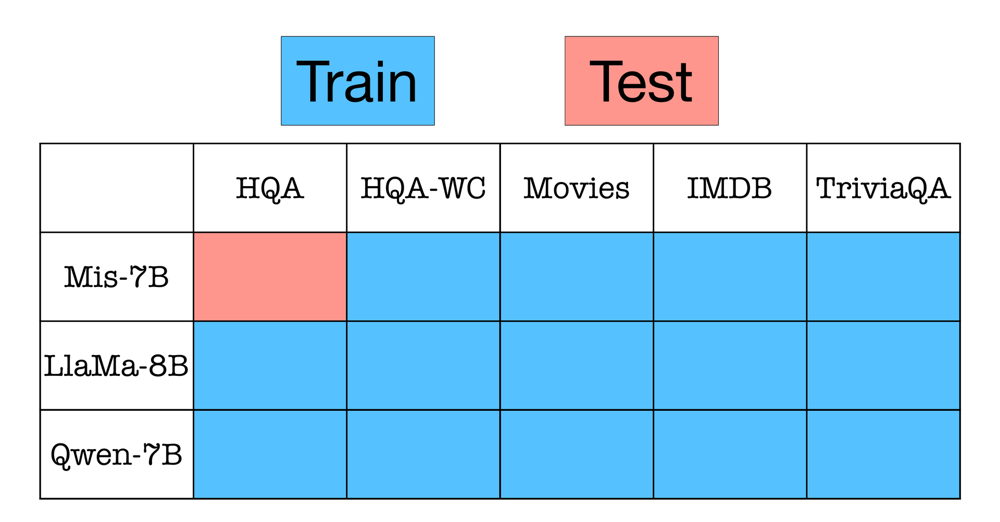
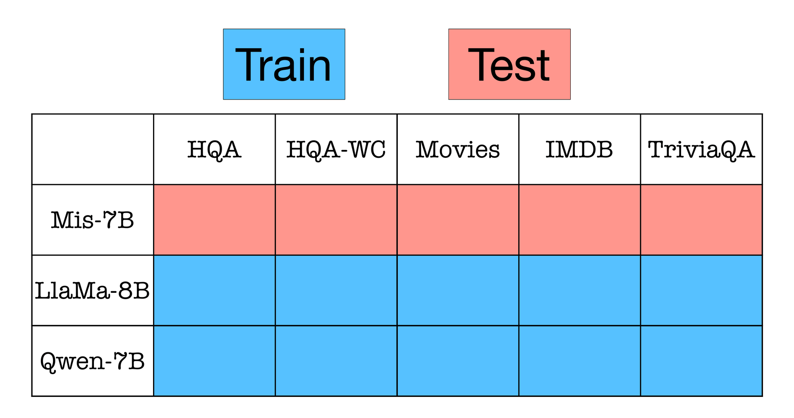

# 📦 ACT-ViT Official Repository

This repository contains the original implementation of **[Beyond Token Probes: Hallucination Detection via Activation Tensors with ACT-ViT](https://arxiv.org/abs/2510.00296)** (*NeurIPS 2025*)

# Overview
We explore predicting hallucinations (or errors) of LLMs via learning over *Activation Tensors*. Those are tensors in $\mathbb{R}^{L_M \times N \times D_M}$, where $L_M$ is the number of layers of the LLM, $N$ is the number of tokens in the LLMs response, and $D_M$ is the hidden dimension of the LLM. We develop *ACT-ViT*, an architecture that is tailored to learn over these tensors, to predict hallucinations. Below is an illustration of ACT-ViT.


⭐ If you find our implementation and paper helpful, please consider citing our work ⭐ :

```bibtex
@article{bar2025beyond,
  title={Beyond Token Probes: Hallucination Detection via Activation Tensors with ACT-ViT},
  author={Bar-Shalom, Guy and Frasca, Fabrizio and Galron, Yaniv and Ziser, Yftah and Maron, Haggai},
  journal={arXiv preprint arXiv:2510.00296},
  year={2025}
}
```


Below we present the instructions to reproduce all the experiments we conducted in the paper.

# 📚 Table of Contents

- ⚙️ [Installation](#⚙️-installation)
- 🗂️ [Handeling Datasets](#🗂️-handeling-datasets)
    - [Generating Raw Datasets](#generating-raw-datasets)
    - [Preprocess Raw Datasets](#preprocess-raw-datasets)
    - [Generate Splits](#generate-splits)
- 📊 [Experiments](#experiments)
  - [Linear Probe Baseline](#linear-probe-baseline)
  - [Training on All 15 Combinations](#training-on-all-15-combinations)  
  - [Training on Each Dataset Separately](#training-on-each-dataset-separately)  
  - [Leave-One-Dataset-Out (14/15)](#leave-one-dataset-out-1415)  
    - [Low-data regime Adaptation of *Linear Adapter* on the held-out dataset](#low-data-regime-adaptation-of-linear-adapter-on-the-held-out-dataset)  
  - [Leave-One-LLM-Out (10/15)](#leave-one-llm-out-1015)  
    - [Training only a LA on a new LLM](#training-only-a-la-on-a-new-llm)


  

# ⚙️ Installation

```bash
# Create the environment
conda env create -f ACT_ViT_env.yml --name ACT_ViT_env

# Activate it
conda activate ACT_ViT_env
```

# 🗂️ Handling Datasets

<details>
<summary><b>📦 Available Datasets & Models</b></summary>

> **Datasets**  
> 1. `imdb` `imdb_test`  
> 2. `movies` `movies_test`  
> 3. `hotpotqa` `hotpotqa_test`  
> 4. `triviaqa` `triviaqa_test`  
> 5. `hotpotqa_with_context` `hotpotqa_with_context_test`  
>
> **Models**  
> 1. `Mistral-7B-Instruct-v0.2`  
> 2. `Meta-Llama-3-8B-Instruct`  
> 3. `Qwen2.5-7B-Instruct`

</details>

<br>

All those text datasets are supported out of the box and do not require manual downloads, except for the TriviaQA dataset.

To download the **TriviaQA dataset**, run the following script.  


```bash
chmod +x data/download_triviaqa_unfiltered.sh && ./data/download_triviaqa_unfiltered.sh
```

Next, we generate the raw *Activation Tensors* for all dataset and model combinations (15 in total).

## Generating Raw Datasets

This step processes the text datasets through the LLMs and stores:

- Extracted *Activation Tensors*  
- Correctness *Labels* for each model output  

⚠️ **Warning:**
 1. The generated raw datasets are very large (approximately **4 TB**), so make sure you have sufficient storage available before proceeding.
 2. Some LLMs used in our experiments are hosted on Hugging Face and may require an access token. If you encounter permission errors or download failures, please authenticate with your Hugging Face account using a personal access token.


### Required Parameters

Configure the following arguments before running the script below:

- **`BASE_RAW_DATA_DIR`**  
  Directory where all generated raw datasets will be saved.

- **`NUM_PARALLEL_JOBS`**  
  Number of parallel processes to run. Recommended value: **2**.

### Run the Script

```bash
# Make the script executable
chmod +x ./scripts/generate_raw_datasets.sh

# Generate raw datasets
./scripts/generate_raw_datasets.sh \
  [BASE_RAW_DATA_DIR] \
  [NUM_PARALLEL_JOBS]

# Validate generated data
python utils/check_data_files.py \
  --function raw \
  --root_dir_qwen     [BASE_RAW_DATA_DIR]/Qwen/Qwen2.5-7B-Instruct \
  --root_dir_mistral  [BASE_RAW_DATA_DIR]/mistralai/Mistral-7B-Instruct-v0.2 \
  --root_dir_meta     [BASE_RAW_DATA_DIR]/meta-llama/Meta-Llama-3-8B-Instruct
```

- After the process completes, check `data/missing_raw_data_summary.csv` to verify that all expected datasets and models were generated successfully.
- If any datasets or models are missing, refer to the example below.


<details>
<summary><b>My example showing how I generated all raw datasets for every model on my machine.</b></summary>


> ```bash
> # Make the script executable
> chmod +x ./scripts/generate_raw_datasets.sh
>
> # Generate raw datasets
> ./scripts/generate_raw_datasets.sh \
>   raw_data \
>   2
>
> # Verify generated data
> python utils/check_data_files.py \
>   --function raw \
>   --root_dir_qwen     raw_data/Qwen/Qwen2.5-7B-Instruct \
>   --root_dir_mistral  raw_data/mistralai/Mistral-7B-Instruct-v0.2 \
>   --root_dir_meta     raw_data/meta-llama/Meta-Llama-3-8B-Instruct
> ```

---

> In case a dataset for a specific model is missing, you can generate it manually by running the command below:
>
> ```bash
> python create_raw_datasets.py \
>   --dataset <DATASET_NAME> \
>   --LLM <MODEL_NAME> \
>   --base_raw_data_dir <BASE_RAW_DATA_DIR> \
>   --chunk <CHUNK_ID> 
> ```
> Where:
> - **`<DATASET_NAME>`** - The name of the dataset.
> - **`<MODEL_NAME>`** - The name of the model.
> - **`<BASE_RAW_DATA_DIR>`** - The path to the directory where the raw datasets are stored.
> - **`<CHUNK_ID>`** - The chunk id to use for the generation.

> **Note about `<CHUNK_ID>`:**  
> - Dataset generation is split into **10 chunks** for efficiency (there are 10,000 samples in each dataset), indexed from **1 to 10**.  
> - Each chunk *i* corresponds to samples **(i-1)000 → (i-1)999**.

> **Example:**  
> If sample **1500** is missing from the `imdb` dataset for the `mistralai/Mistral-7B-Instruct-v0.2` model, you should regenerate **chunk 2** as follows:
>
> ```bash
> python create_raw_datasets.py \
>   --dataset imdb \
>   --LLM mistralai/Mistral-7B-Instruct-v0.2 \
>   --base_raw_data_dir raw_data \
>   --chunk 2
> ```

> The full list of arguments of supported datasets and models can be found in `utils/constants.py` (`LIST_OF_DATASETS`, `LIST_OF_MODELS`).

</details>

<br>


## Preprocess Raw Datasets

This step processes the raw datasets and stores preprocessed *Activation Tensors* using the pool strategy described in the paper.

⚠️ **Warning:** The preprocessed datasets we will now generate are very large (approximately **1 TB**), so make sure you have sufficient storage available before proceeding.


### Required Parameters

Configure the following arguments before running the script below:

- **`BASE_RAW_DATA_DIR`**  
  Directory where all generated raw datasets will be saved.

- **`NUM_PARALLEL_JOBS`**  
  Number of parallel processes to run. Recommended value: **2**.

- **`BASE_PRE_PROCESSED_DATA_DIR`**  
  Directory where all preprocessed datasets will be saved.

### Run the Script

```bash
# Make the script executable
chmod +x ./scripts/preprocess_raw_datasets.sh

# Preprocess raw datasets
bash ./scripts/preprocess_raw_datasets.sh \
  [BASE_RAW_DATA_DIR] \
  [BASE_PRE_PROCESSED_DATA_DIR] \
  [NUM_PARALLEL_JOBS]

# Verify preprocessed data
python utils/check_data_files.py \
  --function pool \
  --root_dir_qwen     [BASE_PRE_PROCESSED_DATA_DIR]/Qwen/Qwen2.5-7B-Instruct \
  --root_dir_mistral  [BASE_PRE_PROCESSED_DATA_DIR]/mistralai/Mistral-7B-Instruct-v0.2 \
  --root_dir_meta     [BASE_PRE_PROCESSED_DATA_DIR]/meta-llama/Meta-Llama-3-8B-Instruct
```


- After the process completes, check `data/missing_pooled_data_summary.csv` to verify that all expected datasets and models were generated successfully.

<details>
<summary> <b>My example showing how I generated all preprocessed datasets for every model on my machine</b></summary>

> ```bash
> # Make the script executable
> chmod +x ./scripts/preprocess_raw_datasets.sh
> 
> # Preprocess raw datasets
> ./scripts/preprocess_raw_datasets.sh \
>   raw_data \
>   preprocessed_data \
>   2
>
> # Verify preprocessed data
> python utils/check_data_files.py \
>   --function pool \
>   --preprocessed_root_dir_qwen     preprocessed_data/Qwen/Qwen2.5-7B-Instruct \
>   --preprocessed_root_dir_mistral  preprocessed_data/mistralai/Mistral-7B-Instruct-v0.2 \
>   --preprocessed_root_dir_meta     preprocessed_data/meta-llama/Meta-Llama-3-8B-Instruct
>
> ```
>
> ### Preprocess a dataset for a specific model
>
> Use the command below to preprocess any dataset a chosen model. Configure the following arguments before running the script:
>
> * `<DATASET_NAME>`: Name of the dataset to preprocess
> * `<MODEL_NAME>`: Name or path of the target model
> * `<BASE_RAW_DATA_DIR>`: Directory containing the raw datasets
> * `<BASE_PRE_PROCESSED_DATA_DIR>`: Output directory for the preprocessed data
>
> (The full list of arguments of supported datasets and models can be found in `utils/constants.py` (`LIST_OF_DATASETS`, `LIST_OF_MODELS`).
>
> ```bash
> python preprocess_raw_datasets.py \
>   --dataset <DATASET_NAME> \
>   --LLM <MODEL_NAME> \
>   --base_raw_data_dir <BASE_RAW_DATA_DIR> \
>   --base_pre_processed_data_dir <BASE_PRE_PROCESSED_DATA_DIR>
> ```
> ### Example
>
> Preprocess the `imdb` dataset for the `mistralai/Mistral-7B-Instruct-v0.2` model:
> ```bash
> python preprocess_raw_datasets.py \
>   --dataset imdb \
>   --LLM mistralai/Mistral-7B-Instruct-v0.2 \
>   --base_raw_data_dir raw_data \
>   --base_pre_processed_data_dir preprocessed_data
> ```

</details>

<br>

## Generate Splits

**Please skip this, since you should have already have the splits in the `data/dataset_splits` directory.** 

Otherwise to generate the splits (80/20 split), run the following command:

```bash
python create_datasets_split.py \
  --base_raw_data_dir <BASE_RAW_DATA_DIR> \
  --output_base_dir <BASE_SPLITS_DIRECTORY>
```


<details>
<summary> <b>My example showing how I generated all splits </b></summary>

>
> ```bash
> python create_datasets_split.py \
>   --base_raw_data_dir raw_data > \
>   --output_base_dir ./data/dataset_splits
> ```

</details>

<br>


# Linear Probe Baseline

### Required Parameters

Configure the following arguments before running the script below:

- **`BASE_RAW_DATA_DIR`**  
  Directory where all generated raw datasets will be saved.

### To run all probes for all datasets and models:

```bash
# Make the script executable
chmod +x ./scripts/run_all_probes.sh

# Run all probes for all datasets and models
./scripts/run_all_probes.sh \
  [BASE_RAW_DATA_DIR]

# Analyze the results (1) collect the best test AUC based on validation results (2) get layer/token AUC heatmaps
python probing_analysis.py

```


All results will be saved in the `probing_baselines` directory.
 - The summary for the best overall probe, for each dataset, model, and size limit, will be saved in the `probing_baselines/summary_table_SIZE_LIMIT_{size_limit}.csv` file.
 - The heatmaps will be saved in the `probing_baselines/heatmaps` directory.
 - It will also save a number of files within nested subdirectories of the `probing_baselines` directory, corresponding to each dataset, model, and size limit; however, these files do not require user attention.

# Experiments

⚠️ **Important note:** before running the experiments, make sure to do a global change of the `base_pre_processed_data_dir` parameter in all the sweeps inside the folders `sweeps` to the path of your preprocessed data.

## Training on All 15 Combinations


```bash

#######################################
# 1) Create W&B sweeps
#######################################

# ACT-ViT sweep
wandb sweep sweeps/15_15/Training_sweep.yaml

# ACT-MLP sweep
wandb sweep sweeps/15_15/Training_sweep_MLP.yaml


#######################################
# 2) Run sweep agent on a specific GPU
#######################################

# Required variables
# GPU_IDX        -> GPU index to use (ex: 0)
# WANDB_USERNAME -> Your wandb username
# SWEEP_ID       -> Sweep ID returned from wandb sweep command

CUDA_VISIBLE_DEVICES=<GPU_IDX> && wandb agent <WANDB_USERNAME>/ACT-ViT/<SWEEP_ID>


#######################################
# 3) Export sweep results to CSV
#######################################
# Output file:
# Results/<PROBE_MODEL>_15_15.csv

# ACT-ViT results
python utils/results_scraper.py \
  --link https://wandb.ai/<WANDB_USERNAME>/ACT-ViT/sweeps/<SWEEP_ID_ACT_VIT> \
  --probe_model "ACT-ViT-foundation"

# ACT-MLP results
python utils/results_scraper.py \
  --link https://wandb.ai/<WANDB_USERNAME>/ACT-ViT/sweeps/<SWEEP_ID_ACT_MLP> \
  --probe_model "ACT-MLP-foundation"
```


## Training on Each Dataset Separately

All sweep configurations for this setting are located in:

- `sweeps/1_15/ACT_ViT`.
- `sweeps/1_15/ACT_MLP`.

Each directory contains 15 individual sweep files, corresponding to every LLM and dataset combination. After launching a sweep, all runs and metrics will be automatically logged to the associated Weights & Biases project page.


## Leave-One-Dataset-Out (14/15)

<div align="center">



*Setup: We train on 14 out of 15 datasets and test on the held-out dataset*

</div>

All sweep configurations are located in:

- `sweeps/leaving_one_dataset_out_14_15/ACT_ViT` for ACT-ViT.
- `sweeps/leaving_one_dataset_out_14_15/ACT_MLP` for ACT-MLP.

When you run a sweep, ROC-AUC scores are logged for **all** test datasets (for each model).  
To get the zero-shot performance on the held-out dataset, simply find its corresponding ROC-AUC entry in Weights & Biases.


### Low-data regime adaptation of *Linear Adapter* on the held-out dataset


All the sweeps are located in:

- `sweeps/leaving_one_dataset_out_14_15/ACT_ViT/Low_data_adaptation_pretrained_14_15`.
- `sweeps/leaving_one_dataset_out_14_15/ACT_MLP/Low_data_adaptation_pretrained_14_15`.

They are all configured to run on `[500, 1000, 2000, 5000, 10000]` size limits as in the paper. If you want to run on a different size limit, you can simply change the `size_limit` parameter in the relevant sweep.

⚠️ **Important note before running the sweeps:** to run these sweeps, update the `wandb_link` parameter of a given sweep to point to a Weights & Biases sweep of a pre-trained ACT-ViT or ACT-MLP model that excludes **the same dataset**. To clarify, if you are running the sweep for the `triviaqa` dataset, the `wandb_link` parameter should point to a pre-trained model that excludes the `triviaqa` dataset. The code will automatically load the best-performing checkpoint from that sweep, selected based on validation AUC, and use it as the pre-trained model.


## Leave-One-LLM-Out (10/15)

<div align="center">



*Setup: We train on 2 out of 3 LLMs and test on the held-out LLM*

</div>

All sweep configurations are located in:
- `sweeps/leaving_one_LLM_out_10_15/ACT_ViT` for ACT-ViT.
- `sweeps/leaving_one_LLM_out_10_15/ACT_MLP` for ACT-MLP.


### Training only a LA on a new LLM

All the sweeps are located in:
- `sweeps/leaving_one_LLM_out_10_15/ACT_ViT/LA_training_pretrained_10_15` for ACT-ViT.
- `sweeps/leaving_one_LLM_out_10_15/ACT_MLP/LA_training_pretrained_10_15` for ACT-MLP.

They are all configured to run on `[10000]` size limit as in the paper. If you want to run on a different size limit, you can simply change the `size_limit` parameter in the relevant sweep.


⚠️ **Important note before running the sweeps:** to run these sweeps, update the `wandb_link` parameter of a given sweep to point to a Weights & Biases sweep of a pre-trained ACT-ViT or ACT-MLP model that excludes **the same LLM**. To clarify, if you are running the sweep for the `triviaqa` dataset over the `Meta-Llama-3-8B-Instruct` model, the `wandb_link` parameter should point to a pre-trained model that excludes the `Meta-Llama-3-8B-Instruct` model. The code will automatically load the best-performing checkpoint from that sweep, selected based on validation AUC, and use it as the pre-trained model.


